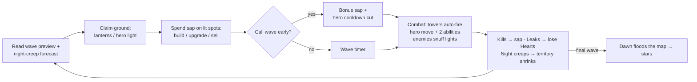
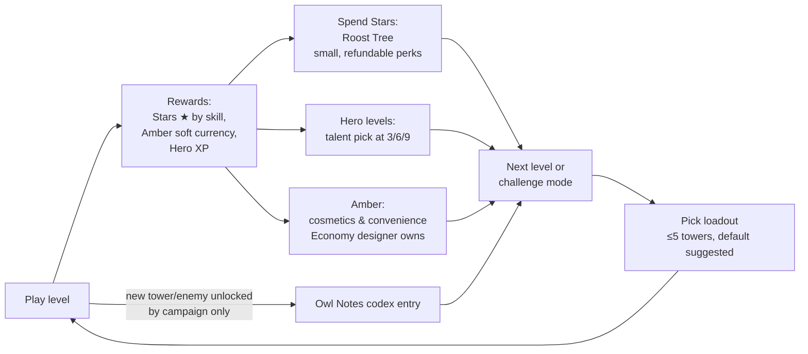

# 02 — Game Design Document v0.1 (Vertical Slice): *Hollowguard* (working title)

> **Lead note (v0.2):** §4 ring menu is superseded by the **bottom-tray** build flow (Decisions Log #9). In-level currency is **Sap**, meta is **Amber** (#11). See `../01-decisions-log.md`.

**Author:** Lead Game Designer · **Status:** v0.1 draft for the concept gate · **Scope:** World 1 (10 levels), 6 towers, 1 hero, 8 enemies + 1 boss
**UX constraints applied (Lead):** every map fits one portrait screen with no pan or zoom. Enemies enter at the top and the Hollow Tree sits at the bottom. Build spots go only in the lower ~70% (below y≈230 on a 390×844 screen). Each level allows a loadout of 5 towers or fewer. UX names are used: *Dawnburst*, *Dusk Moth*, *Murk Crawler*, *Snuffer*. Default visuals are balanced and readable, never near-black.
**Hook direction:** the Lead set it to **"Light is territory."** The idea of a lantern that reveals hidden enemies is deliberately *not* part of the design (see §3.1).
**Note on numbers:** all values are first-pass placeholders. They are meant to be tuned in headless balance simulations (§9), not approved as they are.

---

## TL;DR

- **Pitch:** *Hold back the night one lantern at a time. You can only build on lit ground, shadow creatures snuff your lights, and only your owls keep fighting in the dark.*
- **Hook rules:** light is a **binary tile state**. **Lit** build spots are your territory: you can build and upgrade only there. **Night creeps** in on a telegraphed schedule. **Lightbound** towers (squirrels, glowcaps, crystal) hit hard but **go dormant in the dark**. **Owl** towers are weaker per sap but **fight on in the dark**.
- **Content:** 6 towers (3 Owl, 3 Lightbound), each with a T1 → T2 → T3 choice between 2 branches. 1 hero, Umber the Lamplighter: a **mobile light** that claims ground and wakes towers. 8 enemies that attack your territory. Boss: Nyxmaw, the Hollow Eclipse.
- **World 1:** one portrait screen per map: enemies enter at the top, the Tree is at the bottom. Loadout is capped at 5 towers. One new idea per level, with a sawtooth curve. 3★ come from keeping Hollow Hearts. There are 2 challenge modes per level (*New Moon*, *Ember Vigil*), and 50 skill marks in total.
- **Fair meta:** power is bought only with stars earned by skill. It is capped at about 15% and can be refunded freely. Towers are unlocked only by playing. Monetization hooks are cosmetic, Amber (soft currency) or convenience only. The Economy designer owns the details.

---

## 1. Pitch and design pillars

**One-sentence pitch:** *Hollowguard* is a portrait, one-thumb tower defense where you hold back the night one lantern at a time. You can only build on lit ground, shadow creatures snuff your lights, and only your owls keep fighting in the dark.

| # | Pillar | What it means | What it forbids |
|---|---|---|---|
| 1 | **Read the night at a glance** | One portrait screen with no pan or zoom. Enemies enter at the top and the Tree is at the bottom. You can tell in under 0.5 s whether a spot is buildable and whether a tower is awake. Stats are one tap away. | Gradient lighting that matters for gameplay, more than 5 options in a ring menu, camera pan or zoom, near-black "darkness" |
| 2 | **Light is territory** | Every lantern claims ground and the night takes it back. Where you put light decides *where* you can fight. | Static maps where territory never changes, a "correct" lantern spot on every map |
| 3 | **Cozy look, crunchy decisions** | Warm amber against soft violet, cute owls, real trade-offs (Owl vs Lightbound). Levels last 3–6 minutes. | Gore, punishing grind, fiddly APM checks |
| 4 | **Skill earns the stars** | Every level can be 3-starred with zero meta upgrades. Meta adds options and a small amount of power, never a gate. | Paywalled towers, energy timers that block play, ad-for-continue counting toward 3★ |

These pillars follow published TD design principles. Defender's Quest's design philosophy is "Let the player FOCUS. Test the player's THINKING". It also says "You should be able to glance at the board and immediately know what's going on", with enemy archetypes having "clear roles" (Doucet, search snippet). Stardock's genre essay argues that a "super tower" removes strategic consideration (snippet). That is why we have no dominant tower and why every T3 branch is a sidegrade.

---

## 2. Loops

### 2.1 Core loop (in-level, ~20–35 s per wave cycle)

### 2.2 Meta loop (between levels)

---

## 3. The hook: Light is territory

### 3.1 Why this framing (and not the original "lantern reveals")
- **Differentiation.** The Market Analyst (relayed by the Lead; I have not verified this myself) found a recent competitor whose identity is a lantern tower revealing hidden enemies. My research found the same idea in jam and indie games. *Interstellar Defenders* keeps enemies hidden until they enter a tower's light radius. In the *Might* prototype, towers "cannot target enemies in darkness" (search snippets). Both use light as **vision**. We use light as **ground**: a TD-native take on the territory/power-field idea from RTS games. I found no TD whose identity is built on it, but that search was snippet-level only.
- **Better decisions.** Vision-based light becomes a tax ("build lantern, then everything works"). Territory light creates a spatial *expansion* decision every wave: claim forward ground for strong Lightbound towers, or hold back with Owls that don't care.
- **Theme payoff.** Owls are night hunters, so they are literally the unit that holds the dark. Dawn at the end of each level is the natural victory beat.
- **Risk/reward precedent.** Darkest Dungeon's torch shows that light works best as a dial: "benefits... increase as the light decreases" (snippet). Owl towers in the dark are our "low light" option.

**Alternatives I considered and rejected:** day/night build/fight phases (they split sessions and are a common pattern), a sap-root power network (hard to read on a small screen), and a lantern-reveal hook (prior art, as above).

### 3.2 Rules (the whole system fits on one card)

| Rule | Definition | Readability cue (portrait) |
|---|---|---|
| **R1 Tile light** | Each tile is **Lit** or **Dark** (boolean grid, ~9×15). Light sources: the **Hollow's glow** (permanent, around the base), **Moonpools** (map zones), **Lanterns**, **Umber's lantern-staff**, **Dawnburst** | Lit tiles have a warm amber wash. Dark tiles have a **light** cool violet-blue tint (~25–30%) over full-colour art, **never near-black**. Enemies on Dark tiles stay fully readable and gain only a violet rim plus a small Murk pip. A light radius has a crisp dotted edge. |
| **R2 Territory** | You can **build or upgrade only on Lit build spots**. Selling works anywhere. | Lit spot: glowing amber ring. Dark spot: violet with a crescent lock. |
| **R3 Night creeps** | Night advances **from the top (spawn) down toward the Tree**: Moonpools shrink on a fixed per-level schedule as the moon sets. The *next* wave's loss is **forecast one wave ahead**. | Dotted violet forecast line plus a small moon icon on the wave bar |
| **R4 Lightbound** | Lightbound towers on a Dark spot go **Dormant** (stop acting). Their damage to enemies standing on Dark tiles is reduced by **Murk (−40%)**. | A dormant tower is desaturated with its glow out and a "zz" icon. |
| **R5 Owls hold the dark** | Owl towers and the hero **keep fighting on Dark spots and ignore Murk**, but have ~25–30% lower damage per sap than Lightbound towers. | 🦉 badge on tower card and build ring |
| **R6 The night fights back** | Enemies attack *territory*, not just Hearts: they snuff lanterns, leave dark trails, burst into dark clouds and shroud allies. The boss eclipses the map. | A sabotaged light flickers and shows a countdown ring. |

Short version: **Light lets you build. Lightbound needs light. Owls don't. The night takes ground back.**

**Example decision (L5):** a strong Prism spot sits just outside your light. You can spend 80 sap on a Lantern to claim it, knowing Snuffers will attack that lantern later. Or you can drop a Talon Roost on the edge of your light and let it fight on after the moon sets. Alternatively, Umber's staff can light the spot long enough to build an Owl tower there. That tower keeps working after he leaves.

**Why this works on a portrait phone:** gameplay state is boolean per tile, and there are only two questions to read: *can I build here?* (ring colour) and *is this tower awake?* (glow on or off). The grid is deterministic and cheap on low-end Android, and it can be simulated headlessly in CI (hard constraint #3). Light rings are drawn only while you are placing a tower or have one selected. When you are placing a lantern, the ghost lights up every build spot it would unlock.

**Experiment E1 ("Creep rate," A/B in L2–L6):** Moonpools shrink by 0 / 1 / 2 tiles of radius per wave. Choose the lowest rate that still gives H2 placement variety.

### 3.3 Testable hypotheses

| ID | Hypothesis | Test | Pass bar |
|---|---|---|---|
| H1 | Territory and dormant states are readable | 5-second screenshot test: "where can you build? which towers are asleep?" | ≥80% correct |
| H2 | Light placement is a real choice | Heatmap of first lantern placement on L2, L5 and L8 | ≥3 distinct spots each with ≥15% share |
| H3 | Owl vs Lightbound is a real trade-off | Share of sap spent per class across testers, L5–L9 | Neither class above 70% for the median player |
| H4 | The hero's mobile light gets used | Share of hero moves that end on a Dark build spot or next to a dormant tower | ≥40% |

---

## 4. Portrait one-thumb controls

**Map frame:** every map fits one 390×844 portrait screen with **no pan or zoom**. Enemies enter at the top edge and the Hollow Tree (with its permanent glow) sits at the bottom. **All build spots are below y≈230**, i.e. the lower ~70% of the map. The top band holds the HUD and the enemy entry lanes only. Expect 8–12 build spots per map.

The layout is in three zones. **Top (~0–230 pt):** HUD (Hearts, sap, a wave bar shaped like a moon arc, pause) over the entry lanes. **Middle:** the build area. **Bottom ~15%:** thumb bar (hero portrait, 2 ability buttons, Call-Wave, speed). This follows thumb-zone guidance to keep primary actions within reach (Fortnite mobile docs and Smashing one-hand guide, snippets).

| Action | Gesture | Details and safeguards |
|---|---|---|
| **Build** | Tap a lit build spot → ring menu (up to 5 icons, one per loadout tower, as an arc) → tap a tower → **tap again to confirm** | The ghost shows range, class (🦉 or Lightbound) and, for lanterns, which spots it would unlock. On a dark spot a single tap shows "Needs light" and highlights the nearest lantern spot that could reach it. |
| **Upgrade** | Tap tower → ▲ (top of ring) → confirm | Only on lit spots. At T2 → T3 the ring shows **2 branch icons** (left and right). Long-press to compare stats. |
| **Sell** | Tap tower → coin icon (bottom of ring) → confirm | 70% refund. **100% within 10 s of placing** (fat-finger protection). Works on dark spots too. |
| **Target priority** | Tap tower → cycle icon (First / Strong / Saboteur-first) | Default is First |
| **Hero move** | Tap the hero portrait or Umber → tap any point (or drag Umber) | He flies and ignores the path. The destination marker shows his light radius and the spots it will light. |
| **Ability** | Tap the button → drag to aim → release | The reticle sits **~1.5 cm above the thumb**. Drag back onto the button to cancel. A quick tap re-casts at the last target. |
| **Call wave early** | Tap the pulsing **Call Wave** button (bottom-centre) | The bonus is shown on the button |
| **Speed** | Toggle 1× / 2× (bottom-right) | 3× unlocks after World 1. Pause is top-left and the game auto-pauses when the app goes to the background. |
| **Inspect** | Tap an enemy or tower | Shows a stat card plus an Owl Notes entry |
| **Loadout (pre-level)** | Level card → 5 slots, pre-filled with a recommended loadout → one tap on **Defend** | Swap a slot by tapping it. Shown only once more than 5 towers are unlocked (from L7).

There is no pinch, no pan and no two-finger gesture anywhere.

---

## 5. Content tables (first-pass numbers)

**Units:** range and radius in tiles (1 tile ≈ 40 pt on a 390 pt-wide phone). Speed in tiles/s. Costs in **sap** (in-level currency). Dmg types: **P** physical, **S** sonic (ignores armour), **L** light (ignores armour). **Class:** 🦉 Owl (works in the dark, ignores Murk) / ☀ Lightbound (dormant in the dark, Murk applies).

### 5.1 Towers (6)

| Tower (crew) | Class | Role | Cost | T1 | T2 (+cost) | T3-A (+cost) | T3-B (+cost) |
|---|---|---|---|---|---|---|---|
| **Talon Roost** (barn owls) | 🦉 | Cheap single-target DPS, edge holder | 70 | P 10 / 0.8 s (12.5 DPS), r 3.0 | (+80) 16 / 0.75 s (21 DPS), r 3.3 | **Hawkeye Perch** (+150): 40 / 1.2 s (33 DPS), r 4.5. First hit on a target standing in the dark crits ×2 | **Twin Talons** (+150): 2 targets, 12 / 0.55 s each (44 DPS total), r 3.3 |
| **Burrow Gate** (burrowing owls) | 🦉 | Blockers: hold enemies in kill zones | 90 | 2 guards, 80 HP, P 6/s, respawn 10 s, rally r 2 | (+70) 3 × 130 HP, 9/s | **Bramble Wardens** (+160): 3 × 260 HP, 25% P armour, taunt | **Night Raiders** (+160): 3 × 160 HP, 18/s. **Ambush:** first hit on an enemy on a Dark tile stuns it for 1 s |
| **Screech Spire** (screech owls) | 🦉 | Pulse AoE + slow; hits flyers | 100 | S 8 to all in r 2.2 every 2 s, slow 25% 1.5 s | (+80) S 12, slow 30%, r 2.4 | **Hush Spire** (+170): slow 45%. **Hush:** enemies in radius can't use abilities (snuff, trails, shroud) | **Shatter Cry** (+170): S 26 pulse, −25% armour for 4 s |
| **Glowcap Lantern** (firefly-tended mushroom) | ☀ (is a light) | **Claims territory**; no attack | 80 | Light r 2.5 | (+70) r 3.0; Lit enemies in radius take +10% dmg | **Sunstone Beacon** (+160): r 3.8, **Steadfast** (immune to snuff, clouds and eclipse) | **Will-o'-Wick** (+160): r 3.0, L burn 8 DPS to all in radius, ×2 vs Saboteurs |
| **Pinecone Lobber** (red squirrels) | ☀ | Ground AoE splash; can't hit flyers | 110 | P 30 splash r 0.8 / 2.4 s, range 3.5 | (+90) 48 splash r 0.9 / 2.2 s | **Resin Bomb** (+180): 60 splash + 40% slow 2 s + amber slow-pool 3 s | **Thornburst** (+180): 100 splash r 1.3 / 2.4 s |
| **Moonglass Prism** (crystal) | ☀ | Ramp beam, anti-tank; **Lit targets only** | 140 | L beam 20 → 40 DPS over 3 s, r 3.2 | (+120) 30 → 60 DPS | **Lunar Lance** (+220): 45 → 110 DPS, r 3.8 | **Refractor** (+220): 35 → 70 DPS, chains to 2 more Lit targets at 50% |

**Design notes**
- **Class trade-off:** Lightbound towers deliver ~25–30% more damage per sap, but every dark tile costs them (dormancy, Murk). Owls are the insurance. The boss's Total Eclipse (§5.3) is the exam on that insurance.
- **No reveal mechanic:** no enemy is invisible and no tower "reveals". Light changes *where you can build and what works*, not what you can see.
- Each T3 pair splits into a *specialist* and a *generalist* so no branch strictly dominates.
- **Sanity check:** a Nightling (60 HP, 1.0 t/s) crosses ~6 tiles of a Talon's coverage and takes ~75 damage (dies). A Lobber hitting the same grunt in the dark does 40% less, which shows Murk's value early.

### 5.2 Hero: Umber the Lamplighter (eagle-owl)

| Stat / ability | Value | Notes |
|---|---|---|
| Base | 400 HP, P 22 / 1.0 s, range 1.5, blocks 1 ground enemy, hits flyers, flies at 2.5 t/s, respawns in 12 s | 🦉 Owl (fights in the dark) |
| **Passive: Lantern-staff** | Personal light r 1.5 that **moves with him**. It counts as territory, so spots in it are buildable and Lightbound towers in it wake up. | The hero's hook: a mobile claim. Park him to light a spot, build an Owl tower, move on, and the tower keeps fighting. |
| **Active 1: Dawnburst** | CD 30 s. Target point: Lit r 3 for 8 s (it ignores snuffs and clouds) | Answers sabotage, wakes a dormant cluster, and opens a temporary build window |
| **Active 2: Silent Dive** | CD 18 s. Umber dives to a point: P 90 in r 1.0, 1 s stun, and he *stays there* | Saboteur assassination and a fast reposition |
| Meta levels 1–10 | +4% HP/dmg per level. Talent pick (1 of 2) at levels 3/6/9 | L3: *Bright Staff* (glow r 2.0) / *Long Dawn* (12 s). L6: *Rending Talons* (−20% armour on hit) / *Swift Wings* (+40% move). L9: *Bright Dawn* (Dawnburst r 4.5) / *Twin Dive* (2 charges) |

### 5.3 Enemies (8) + boss

**Saboteur** tag means the enemy attacks territory. The Will-o'-Wick does ×2 to these, and Hush silences them.

| Enemy | HP | Spd | Armour | Sap | ♥ lost | Trait | Main counters |
|---|---|---|---|---|---|---|---|
| **Nightling** | 60 | 1.0 | — | 5 | 1 | Baseline grunt | Anything |
| **Skitterdark** | 22 | 1.7 | — | 2 | 1 | Packs of 6–10 | Lobber, Screech, Twin Talons |
| **Mirebrute** | 450 | 0.55 | 50% P | 25 | 3 | Tank | Prism, Shatter Cry; Bramble Wardens to stall |
| **Dusk Moth** | 80 | 1.2 | — | 8 | 1 | **Flying**: ignores blockers; Lobber can't hit it | Talon, Screech, Prism, Umber |
| **Snuffer** (Saboteur) | 160 | 0.9 | 10% P | 15 | 2 | **Snuff**: inside a lantern's radius, puts it out for 5 s (CD 12 s), so territory flickers | Kill it before it reaches lanterns; Sunstone Beacon; Hush; Dawnburst |
| **Murk Crawler** (Saboteur) | 120 | 1.0 | — | 12 | 1 | **Dark trail**: tiles it crosses turn Dark for 6 s (overrides non-Steadfast light) | Owls along its route; kill it early; Will-o'-Wick |
| **Inkbloat** (Saboteur) | 300 | 0.6 | — | 20 | 2 | On death: **dark cloud** r 1.5 for 6 s | Kill it *before* your Lightbound cluster; Beacon; Night Raiders like the cloud |
| **Nightweaver** (Saboteur) | 200 | 0.8 | — | 20 | 2 | Every 6 s gives allies within r 2 a **Nightshroud**: they count as on Dark tiles for 4 s (Murk vs Lightbound; Prism can't target them) | Owls (ignore it), Hawkeye range, Silent Dive, Hush |
| **BOSS: Nyxmaw, the Hollow Eclipse** | 7,000 | 0.35 | 30% P | 300 | all | **P1** Eclipse Pulse every 20 s: puts out lights within r 4 for 6 s. **P2 (66%)** sheds 3 Murk Crawlers every 15 s. **P3 (33%)** **Total Eclipse**: the whole map goes Dark for 8 s, except the Hollow glow and Steadfast lights, so *only Owls fight*. Then the Dawn finale | Beacons on the late path, Dawnburst timed to the pulses, Prism burst in lit windows, a solid Owl backbone for the Eclipse |

Every enemy either breaks one habit or attacks territory. This follows the genre rule that waves should introduce "enemy types that counter certain strategies" (bugnet guide, snippet).

---

## 6. World 1, "The Rootwood": level structure

**Run shape:** 6–12 waves of ~20–35 s each, 3–6 min at 1×, **20 Hollow Hearts**. **Call Wave** early bonus: +1 sap per remaining second (max +20) and −1 s on hero cooldowns per 2 s remaining. Early calling is a genre convention (KR article and KR5 guide snippets). Every wave also gives a guaranteed **Hollow tithe of +15 sap** to prevent death spirals (Whitevale "fixed money each wave" principle, snippet).

| # | Level | New tower / hero | New enemy | Mechanic taught | Waves | Start sap | Map / night notes | Curve |
|---|---|---|---|---|---|---|---|---|
| 1 | First Watch | Talon Roost 🦉 | Nightling | Build on lit ground, upgrade, Call Wave | 6 | 220 | Full moon, no creep. 2 dark spots visibly locked | ▁ |
| 2 | Lantern Row | Glowcap Lantern | — | **Territory**: lanterns unlock spots; **night creep** forecast | 7 | 240 | One Moonpool sets mid-level | ▂ |
| 3 | Skitter Hollow | Pinecone Lobber ☀ | Skitterdark | **Lightbound**: dormancy and Murk; AoE vs swarm | 8 | 260 | Lobber spots sit at the edge of the creep | ▄ |
| 4 | The Lamplighter | **Hero Umber** | Dusk Moth | Mobile light, claiming with the staff, 2 abilities; flyers | 8 | 260 | Dark build pockets only the hero can open | ▃ |
| 5 | Burrow Gate | Burrow Gate 🦉 | Mirebrute | Blocking, armour. **T3 unlocks** for Talon and Lantern | 9 | 280 | 2 paths merge | ▅ |
| 6 | Snuffer Grove | Screech Spire 🦉 | Snuffer | Enemies attack lights; slows; Hush. T3 for Lobber and Burrow | 10 | 300 | Lantern-dependent layout | ▆ |
| 7 | Prism Glade | Moonglass Prism ☀ | Murk Crawler | Strongest Lightbound vs dark trails. T3 Screech | 10 | 320 | Few Moonpools, fast creep | ▄ |
| 8 | Ink Marsh | — | Inkbloat | Kill-zone placement vs dark clouds. T3 Prism | 11 | 340 | Waning moon | ▆ |
| 9 | Weaver's Crossing | — | Nightweaver | Mastery mix, Owl/Lightbound balance | 12 | 360 | 2 spawns, new-moon edges | ▇ |
| 10 | Eclipse at the Hollow | — | **Nyxmaw** | Everything; holding through Total Eclipse | 8 + boss | 400 | The wave bar ends at *dawn* | █ |

**Loadout cap (≤5):** towers unlocked by level are L1: 1, L2: 2, L3–4: 3, L5: 4, L6: 5, L7+: 6. From L7 the player drops one tower before each level. This is a small, meaningful pre-level choice; for example, skipping Prism makes the run Owl-heavy. Ember Vigil fixes a loadout of 3.

**Curve:** a sawtooth. Levels that introduce a new tool ease off (L4, L7), and mixing levels spike (L6, L9). The Kingdom Rush campaign-design analysis praises steady one-concept-at-a-time introduction (snippet). Within each level, waves also follow a sawtooth: a "breather" wave after each spike.

**Stars (Campaign):** 1★ for a win · 2★ for ≥10 ♥ · 3★ for ≥18 ♥. Maximum is 30★.

**Challenge modes** (unlock once the level is cleared; each awards 1 **Moon Crest**, 20 in total):

| Mode | Rule | Tests |
|---|---|---|
| **New Moon** | No Moonpools: your only starting territory is the Hollow's glow | Expanding territory from scratch |
| **Ember Vigil** | 1 ♥, a fixed roster of 3 towers, remixed waves, no early-call bonus | Precision and composition |

These are our own rule sets. One-life and restricted-roster challenges are a genre convention (KR wiki snippets), but we do not reuse names or structures.

**Target first-try win rates** (from bot plus human tests): L1 99% · L2 95% · L3 90% · L4 90% · L5 80% · L6 70% · L7 75% · L8 65% · L9 55% · L10 50%. The 3★ rate should be about half of each.

---

## 7. Difficulty and tutorial philosophy

**Principles:** *teach by play, one concept per level, no text wall.* This follows Apple's onboarding guidance (retrieved): "teach one step at a time using short and clear instructions". It also says to let players "demonstrate what they've learned by playing unguided" and to avoid "splash screens, menus, agreements, or disclaimers" at launch.

**The first 60 seconds (L1, first launch, no menu first):**

| t (s) | Beat | Player action | On-screen text (≤ 8 words) |
|---|---|---|---|
| 0–5 | Night falls; the Hollow glows amber; shadows gather at the top edge | — | "Shadows come. Build where it's lit!" |
| 5–12 | One lit spot pulses; the ring has only Talon | Tap, tap | — |
| 12–22 | Wave 1: 3 Nightlings pop with big numbers | Watch; sap ticks up | — |
| 22–32 | The player taps a dark spot: crescent lock, "Needs light". Then they build on one of two lit spots. | Learns the territory rule by trying it | "Owls build only in light." |
| 32–45 | Wave 2 walks through a dark stretch and the Talon keeps hitting | Notice | "Owls hunt in the dark." |
| 45–55 | Upgrade ▲ pulses | Upgrade | — |
| 55–60 | Call Wave glows showing "+12 sap" | Call early, then **no more prompts** | — |

**Safety and accessibility**
- **Safety net:** on the first L1 run only, the Hollow's roots smack the last leaking enemy once (a story beat).
- **Codex:** the first time a new enemy or tower appears, an Owl Notes card slides in and can be tapped (it auto-dismisses in 3 s).
- **Difficulty modes per level:** *Cozy* (−30% enemy HP, slower creep, max 2★) and *Keeper* (standard, full stars). Challenges use Keeper rules.
- **Accessibility:** Lit/Dark, the build lock and dormancy are all shown by **shape and icon**, not only by colour. Plus colour-blind-safe palettes, haptics when an enemy leaks, and minimum text of 14 pt.

---

## 8. Meta progression outline (fair by design)

| System | Earned by | Spent on | Fairness guardrail |
|---|---|---|---|
| **Stars ★ + Moon Crests** (max 50 in W1) | Skill only | **Roost Tree**: 3 nodes per tower + 3 global (e.g., Lantern r +0.3, Talon +8% dmg, Hollow glow r +0.5) | Total cap ≈ +15% effective power. **Free respec.** Levels are balanced assuming ~50% of the tree. Every level can be 3★ with 0 nodes (verified by bot) |
| **Hero XP** | Playing levels (more for first clears) | Umber levels 1–10, talent picks | Talents are sidegrades |
| **Amber** (hardened sap, soft currency) | Level rewards, daily, pass | Cosmetics, hero skins, lantern *glow styles*, optional convenience | **Cannot buy towers, stars or Roost nodes.** Gameplay light colours stay within the readable warm band |
| **Unlocks** | Campaign progress | Towers, T3 branches, challenges | Never sold |

**Hooks for the Economy & LiveOps designer** (I define the hooks only, not the prices):
1. A rewarded ad after the level that multiplies **Amber only**.
2. A cosmetic shop with skins and glow styles.
3. An optional premium pass track (cosmetics + Amber).
4. A daily "Night Watch" remix of a cleared level (a modifier plus Amber).
5. **"Second Dawn" continue** (ad or Amber). If it ships, a continued run is **capped at 1★** and gives no crest.

**Design preference:** no energy system.

**Rationale:** "The Pitfalls of Meta Game Design" warns that balancing difficulty around meta progression tethers players to grinding (snippet). Community threads show TD players dislike mandatory meta power.

---

## 9. Recommendations (decisive)

1. **Adopt R1–R6 "Light is territory" exactly as specified.** Gameplay light is a boolean tile grid. Build and upgrade only on lit spots. Lightbound towers go dormant in the dark and suffer Murk at 40%. Owls ignore both. **Ship no invisibility or reveal mechanic.**
2. **Keep the 3 Owl / 3 Lightbound split** with a ~25–30% damage-per-sap gap. This split is the strategic spine. Tune it before anything else.
3. **Make Umber a mobile territory claim** (staff light plus Dawnburst). This ties the hero to the hook with one thumb.
4. **Build all content as data** (towers, enemies, waves, light maps and creep schedules in YAML/JSON) and run a **headless balance bot** in CI. On every level it asserts that (a) 3★ is possible with 0 Roost nodes, (b) neither class alone 3-stars more than 2 levels, and (c) win-rate bands hold.
5. **Playtest H1–H4 and E1 before the vertical-slice gate.** If H3 fails (one class dominates), adjust the damage-per-sap gap first and the creep rate second.
6. **Follow the UX constraints:** one screen with no pan or zoom, top-to-bottom flow, build spots below y≈230, loadout ≤5, UX names (Dawnburst, Dusk Moth, Murk Crawler, Snuffer), and balanced visuals that are never near-black. Level designers must validate every map against these in a headless lint (spot positions, max loadout).
7. **Naming hygiene:** never use the terms "shade(s)", "Flare" or "Gloom King" in names, UI or store text. The Market Analyst should keep a running list of banned terms.

## 10. Risks

| Risk | Likelihood | Mitigation |
|---|---|---|
| Lanterns feel mandatory ("build lantern first") | Med | Owls make holding the dark viable; New Moon mode tests it; H2/H3 heatmaps |
| Dormant towers feel unfair ("my tower just stopped") | Med | One-wave creep forecast; Lightbound towers show a warning flicker 3 s before going dormant; Dawnburst as a fix |
| Visual noise at 2× with territory tint, rings and swarms | Med | Show rings only when selected; tint is per tile; cap on-screen VFX; UX to prototype early |
| One-thumb hero aiming is imprecise on small phones | Med | Offset reticle, re-cast on tap, generous radii |
| Too many rules for cozy players | Med | One rule per level; Cozy mode (slower creep); Owl Notes |
| Clone perception (lane TD conventions, lantern towers in competitors) | Med | Territory framing, no reveal mechanic, banned-term list, original names; Art Director to avoid competitors' lantern silhouettes |
| Loadout cap blocks a needed counter (e.g., no anti-air) | Low–Med | Each level card shows enemy icons; the recommended loadout always covers them; the bot verifies the default loadout can 3★ |
| Dark areas look muddy or too dim on low-brightness phones | Med | Light tint (≤30%), never near-black; dark state shown by rim and icon; Art Director to test at 30% screen brightness |
| Dynamic light cost on low-end Android | Low | Tile grid with baked tint; no per-pixel gameplay lighting |

## 11. Open questions for the Owner

1. **Tone of the shadows:** *cute-spooky* (soft blobs, big eyes, a wider audience and possibly a lower age rating) or *eerie* (thin, unsettling, a more mid-core feel)? This affects art, the age rating and store policy.
2. **Umber as the IP's face:** should the hero be a named character with personality and voice lines (a stronger brand, more writing), or a lightly customizable "your owl captain" (a stronger cosmetic hook)?

---

## Sources

**Retrieval note:** this session's network blocked direct page fetches from gamedeveloper.com and wikipedia.org (DNS and proxy denied). Only the Apple page was fully retrieved. All the others were **seen as search-result listings and snippets only (unverified full text)**. I did not see the competitor finding myself (it was relayed by the Lead from the Market Analyst).

- **Retrieved:** Apple, Onboarding for Games — https://developer.apple.com/app-store/onboarding-for-games/
- Unverified (snippet): L. Doucet, Optimizing Tower Defense for Focus and Thinking (Defender's Quest) — https://gamedeveloper.com/design/optimizing-tower-defense-for-focus-and-thinking---defender-s-quest
- Unverified (snippet): Kingdom Rush — the wonderful Campaign level design — https://www.gamedeveloper.com/design/kingdom-rush---the-wonderful-campaign-level-design
- Unverified (snippet): The Pitfalls of Meta Game Design — https://www.gamedeveloper.com/design/the-pitfalls-of-meta-game-design
- Unverified (snippet): Stardock, Tower Defense as a Genre — https://www.stardock.com/games/article/494035/tower-defense-as-a-genre
- Unverified (snippet): Whitevale Defender, The one problem with all tower defense games — https://www.moddb.com/games/whitevale-defender/features/the-one-problem-with-all-tower-defense-games
- Unverified (snippet): bugnet, How to design a tower defense game — https://bugnet.io/blog/how-to-design-a-tower-defense-game
- Unverified (snippet): *Interstellar Defenders* (light-radius reveal TD) — https://markcooperdev.itch.io/interstellardefenders
- Unverified (snippet; fetch returned 403): *Might* prototype (light-gated targeting) — https://github.com/mindstorm8191/Might
- Unverified (snippet): Darkest Dungeon light level guide — https://www.gamepressure.com/darkestdungeon/light-level-and-its-influence/z28424
- Unverified (snippet): Kingdom Rush Wiki, Iron Challenge — https://kingdomrushtd.fandom.com/wiki/Iron_Challenge
- Unverified (snippet): Smashing Magazine, Design mobile apps for one-hand usage — https://smashingmagazine.com/2020/02/design-mobile-apps-one-hand-usage/
- Unverified (snippet): Epic, Designing for mobile in Fortnite — https://dev.epicgames.com/documentation/fortnite/designing-for-mobile-in-fortnite
- Unverified (snippet): GameAnalytics, FTUE tips for F2P — https://gameanalytics.com/blog/tips-for-a-great-first-time-user-experience-ftue-in-f2p-games
