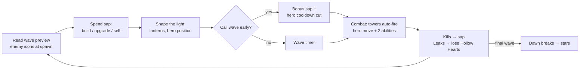
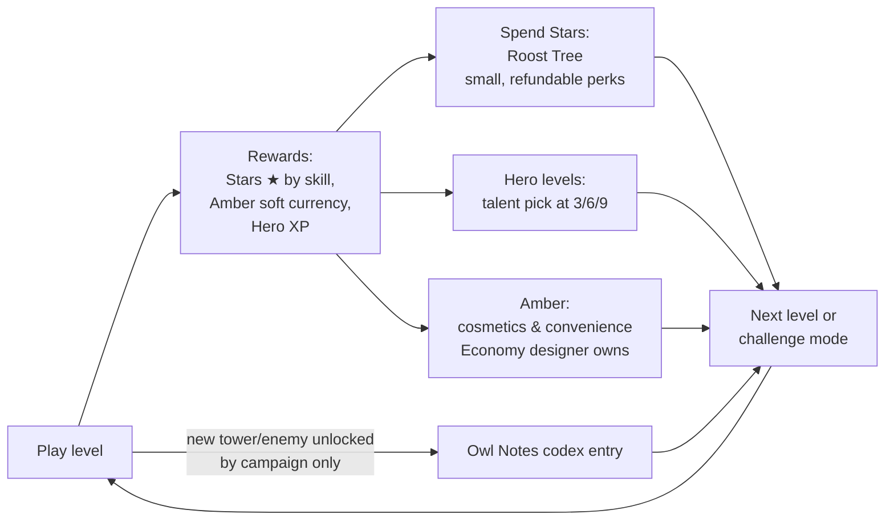

# 02 — Game Design Document v0.1 (Vertical Slice): *Hollowguard* (working title)

**Author:** Lead Game Designer · **Status:** v0.1 draft for the concept gate · **Scope:** World 1 (10 levels), 6 towers, 1 hero, 8 enemies + 1 boss
**Note on numbers:** all values are first-pass placeholders. They are meant to be tuned in headless balance simulations (see §9), not approved as they are.

---

## TL;DR

- **Pitch:** *A portrait, one-thumb tower defense where night-sighted owls protect the Great Hollow Tree, and every lantern you place decides where shadow creatures can be beaten.*
- **The hook is validated and made concrete:** light is a **binary tile state** (Lit or Dark) that you can read in half a second. In the Dark, enemies get **Murk** (−40% damage taken) and some are **Veiled** (only owls with **Nightsight** can target them). Lanterns, the hero's lantern-staff and flares light tiles; enemies snuff, cloud and eclipse them.
- **Content:** 6 towers with a T1 → T2 → T3 choice between 2 branches. 1 hero (Umber the Lamplighter: a moving light source with 2 abilities). 8 enemies, each built to pressure one rule. Boss: Nyxmaw, the Hollow Eclipse.
- **World 1:** one new idea per level, with a sawtooth difficulty curve. You earn 3 stars by keeping Hollow Hearts. There are 2 challenge modes per level (*New Moon*, *Ember Vigil*), and 50 skill marks in total.
- **Fair meta:** power upgrades are bought only with stars earned by skill. They are capped at about 15% effective power and can be refunded freely. Towers are unlocked only by playing. Monetization hooks are cosmetic, Amber (the soft currency) or convenience only. The Economy designer owns the details.

---

## 1. Pitch and design pillars

**One-sentence pitch:** *Hollowguard* is a portrait, one-thumb tower defense where night-sighted owls protect the Great Hollow Tree, and every lantern you place decides where shadow creatures can be beaten.

| # | Pillar | What it means | What it forbids |
|---|---|---|---|
| 1 | **Read the night at a glance** | One screen with no scrolling. Every enemy reads as Lit or Dark in under 0.5 s. Stats are one tap away. | Gradient lighting that matters for gameplay, more than 4 options in a ring menu, camera panning |
| 2 | **Light is a choice, not a tax** | Each light source trades sap, space and exposure to sabotage against damage. Players should place lanterns differently from one another. | A "correct" lantern spot on every map, light that is required just to target basic enemies |
| 3 | **Cozy look, crunchy decisions** | Warm amber against soft violet. Owls are cute, and the decisions are real. Levels last 3–6 minutes. | Gore, punishing grind, fiddly APM checks |
| 4 | **Skill earns the stars** | Every level can be 3-starred with zero meta upgrades. Meta adds options and a small amount of power, never a gate. | Paywalled towers, energy timers that block play, ad-for-continue counting toward 3★ |

These pillars follow published TD design principles. Defender's Quest's design philosophy is "Let the player FOCUS. Test the player's THINKING". It also says "You should be able to glance at the board and immediately know what's going on" and that enemy archetypes need "clear roles" (Doucet, search snippet). Stardock's genre essay argues that a "super tower" removes strategic consideration (snippet). That is why we have no dominant tower and why every T3 branch is a sidegrade.

---

## 2. Loops

### 2.1 Core loop (in-level, ~20–35 s per wave cycle)

### 2.2 Meta loop (between levels)

---

## 3. The hook: Light vs Dark

### 3.1 Verdict
I am keeping **Light vs Dark**. It fits the theme (owls are night hunters, sap glows like caramel), it is visually distinct on a store screenshot, and it adds a **second placement layer** on top of standard TD (where light goes, not just where damage goes). Prior art shows the idea works and shows the trap to avoid. In the *Might* prototype, towers "cannot target enemies in darkness", which turns light into a mandatory tax. *Interstellar Defenders* hides enemies until they enter a tower's light radius (search snippets). Darkest Dungeon's torch shows that light works best as a **risk/reward dial**, not a toggle (snippets: "benefits... increase as the light decreases"). Our design therefore makes darkness a *penalty you can play around*, not a hard gate. The only exception is one enemy type, the Veiled Wispshade.

**Alternatives I considered and rejected:**
- **Day/night phases** (build by day, fight at night). This splits sessions, slows 3–6 min levels, and is a common genre pattern.
- **Sap-root network** (towers powered by flowing sap). It is less visual, hard to read on a small screen, and has no theme payoff.
- **Hard targeting gate** (no light means no shooting). It punishes players, and lanterns become a tax (anti-Pillar 2).

### 3.2 Rules (the whole system fits on one card)

| Rule | Definition | Readability cue |
|---|---|---|
| **R1 Tile light** | Each path tile is **Lit** or **Dark** (boolean grid). Sources: Moonpools (fixed map zones), Lanterns, Umber's lantern-staff, Moonflare. | Lit tiles are warm amber. Dark tiles have a violet overlay (55% opacity). The edge of a light radius is a crisp dotted ring. |
| **R2 Murk** | An enemy on a Dark tile takes **−40% damage** from all sources. | The enemy is drawn as a silhouette with a violet rim and a small shield pip. Damage numbers turn grey. |
| **R3 Veil** | *Veiled* enemies on Dark tiles **cannot be targeted** except by **Nightsight** sources. | The enemy shows only as glowing eyes plus a dashed outline. |
| **R4 Nightsight** | Owl-crewed towers marked 👁 and the hero can target Veiled enemies. Nightsight does **not** remove Murk. | A 👁 badge on the tower card and the build ring |
| **R5 Exposed** | T2+ lanterns, Moonflare and some upgrades make Lit enemies take **+10–20% damage**. | A small amber spark over the enemy |
| **R6 Darkness strikes back** | Some enemies dim lights (Lampsnuffer), drop dark clouds (Gloom Bloat), shroud allies (Shade Weaver). The boss eclipses the map. | Sabotaged lanterns flicker and show a countdown ring. |

Short version: **Light strips armor and reveals. Nightsight only reveals. Darkness fights back.**

**Why this works on a portrait phone:** gameplay state is boolean per tile, so there are no gradients to judge. It is computed on a coarse grid of about 9×15 tiles. That makes it deterministic and cheap on low-end Android, and it can be simulated headlessly in CI (hard constraint #3). There are at most about 10 light sources per level. Rings are drawn only while you are placing a tower or have one selected. The rest of the time, light is shown only as the tile tint.

**Experiment E1, "Dusk Bounty" (A/B in playtests for L2–L6):** enemies killed while Murked give +50% sap. This creates a Darkest Dungeon-style greed choice ("let them into the dark, kill them slower, earn more"). Ship it only if it increases the variety of placements without confusing players.

### 3.3 Testable hypotheses for the hook

| ID | Hypothesis | Test | Pass bar |
|---|---|---|---|
| H1 | Lit vs Dark is readable | 5-second screenshot test: "which enemies are tougher right now?" | ≥80% correct |
| H2 | Light is a choice, not a tax | Heatmap of first lantern placement on L2, L5, L8 across testers | ≥3 distinct spots each with ≥15% share |
| H3 | Murk is felt but not punishing | First-try win rate on L2 with Murk at 25% / 40% / 55% | 40% hits ~90% win and ≥60% of testers place a lantern unprompted |
| H4 | The hero's mobile light is used | Share of hero moves that end in a Dark stretch | ≥40% |

---

## 4. Portrait one-thumb controls

The layout is in three zones. **Top 20%:** HUD (Hearts, sap, wave/moon bar, pause). **Middle 60%:** board. **Bottom 20%:** thumb bar (hero portrait, 2 ability buttons, Call-Wave, speed). Everything you press repeatedly is in the bottom bar, in line with thumb-zone guidance to keep primary actions within reach (Fortnite mobile docs and Smashing one-hand guide, snippets).

| Action | Gesture | Details and safeguards |
|---|---|---|
| **Build** | Tap an empty build spot → a ring menu opens (max 4 icons, unaffordable ones greyed) → tap a tower → **tap again to confirm** | The first tap shows a ghost with range *and* light/Nightsight info. The ring always opens toward the screen centre and bottom so it stays within thumb reach. |
| **Upgrade** | Tap tower → tap the ▲ icon (top of ring) → confirm tap | At T2 → T3 the ring shows **2 branch icons** (left and right). Long-press either one to see a stat comparison. |
| **Sell** | Tap tower → tap the coin icon (bottom of ring) → confirm | Refund is 70%. It is **100% within 10 s of placing**, to protect against fat-finger mistakes. |
| **Target priority** | Tap tower → cycle icon (First / Strong / Veiled-first) | Default is First |
| **Hero move** | Tap the hero portrait (or Umber himself) → tap any board point | You can also drag Umber. He flies, so he ignores the path. A destination marker shows his glow radius. |
| **Ability** | Tap the ability button → drag to aim → release to cast | The reticle sits **~1.5 cm above the thumb** so your finger does not hide the target. Drag back onto the button to cancel. A quick tap re-casts at the last target. |
| **Call wave early** | Tap the pulsing **Call Dusk** button (bottom-centre) | The bonus is shown on the button (+sap, −cooldown) |
| **Speed** | Toggle 1× / 2× (bottom-right) | 3× unlocks after World 1. Pause is top-left and the game auto-pauses when the app goes to the background. |
| **Inspect** | Tap an enemy | Shows a stat card plus an Owl Notes entry. It does not pause the game unless the "inspect pauses" setting is on. |

There is no pinch, no pan and no two-finger gesture anywhere.

---

## 5. Content tables (first-pass numbers)

**Units:** range and radius in tiles (1 tile ≈ 40 pt on a 390 pt-wide phone). Speed in tiles/s. Costs in **sap** (in-level currency). Dmg types: **P** physical, **S** sonic (ignores armour), **L** light (ignores armour).

### 5.1 Towers (6)

| Tower (crew) | Role | 👁 | Cost | T1 | T2 (+cost) | T3-A (+cost) | T3-B (+cost) |
|---|---|---|---|---|---|---|---|
| **Talon Roost** (barn owls) | Cheap single-target DPS, anti-Veil backbone | ✔ | 70 | P 10 / 0.8 s (12.5 DPS), r 3.0 | (+80) 16 / 0.75 s (21 DPS), r 3.3 | **Hawkeye Perch** (+150): 40 / 1.2 s (33 DPS), r 4.5. First hit on a Veiled target crits ×2 | **Twin Talons** (+150): 2 targets, 12 / 0.55 s each (44 DPS total), r 3.3 |
| **Glowcap Lantern** (moth-tended mushroom) | Light source / support, no attack | — | 80 | Light r 2.5 | (+70) r 3.0, Exposed +10% | **Sunstone Beacon** (+160): r 3.8, Exposed +20%, **Steadfast** (immune to snuff, clouds and eclipse) | **Will-o'-Wick** (+160): r 3.0, L burn 8 DPS to all in radius, ×2 vs Spectral |
| **Pinecone Lobber** (short-eared owls) | Ground AoE splash; can't hit flyers or Veiled | — | 110 | P 30 splash r 0.8 / 2.4 s, range 3.5 | (+90) 48 splash r 0.9 / 2.2 s | **Resin Bomb** (+180): 60 splash + 40% slow 2 s + amber slow-pool 3 s | **Thornburst** (+180): 100 splash r 1.3 / 2.4 s |
| **Burrow Gate** (burrowing owls) | Blockers: hold enemies in kill zones | ✔ | 90 | 2 guards, 80 HP, P 6/s, respawn 10 s, rally r 2 | (+70) 3 guards, 130 HP, 9/s | **Bramble Wardens** (+160): 3 × 260 HP, 25% P armour, taunt | **Night Raiders** (+160): 3 × 160 HP, 18/s. **Ambush:** first hit on a Murked enemy stuns it for 1 s |
| **Screech Spire** (screech owls) | Pulse AoE + slow; hits flyers | ✔ | 100 | S 8 to all in r 2.2 every 2 s, slow 25% 1.5 s | (+80) S 12, slow 30%, r 2.4 | **Hush Spire** (+170): slow 45%. **Hear the Hidden:** Veiled enemies in radius become targetable by all towers (Murk stays) | **Shatter Cry** (+170): S 26 pulse, −25% armour for 4 s |
| **Moonglass Prism** (snowy owl) | Ramp beam, anti-tank. **Lit targets only** | — | 140 | L beam 20 → 40 DPS over 3 s, r 3.2 | (+120) 30 → 60 DPS | **Lunar Lance** (+220): 45 → 110 DPS, r 3.8 | **Refractor** (+220): 35 → 70 DPS, chains to 2 more Lit targets at 50% |

**Design notes**
- Each tower answers a specific enemy (see §5.3), and each T3 pair splits into a *specialist* and a *generalist* so no branch strictly dominates.
- The light layer creates the key relationships. **Prism** is the strongest damage dealer but needs light. **Lantern** has no damage and is what saboteurs attack. **Night Raiders** *prefer* darkness, which is the counter-incentive that makes the light map a real puzzle.
- **Sanity check:** one T1 Talon covers ~6 tiles of path. A Gloomling (60 HP, 1.0 t/s) is in range for ~6 s and takes ~75 damage in light (dies) or ~45 in the dark (survives). That shows Murk's value in the first minute.

### 5.2 Hero: Umber the Lamplighter (eagle-owl)

| Stat / ability | Value | Notes |
|---|---|---|
| Base | 400 HP, P 22 / 1.0 s, range 1.5, blocks 1 ground enemy, hits flyers, flies at 2.5 t/s, respawns in 12 s | 👁 Nightsight |
| **Passive: Lantern-staff** | Personal light r 1.5 that **moves with him** | Mobile light is the hero's hook: you can use him to patch a dark stretch |
| **Active 1: Moonflare** | CD 30 s. Throw to any point: Lit r 3 for 8 s, Exposed +20%, reveals Veiled | The "oh no" button against snuffs and eclipses |
| **Active 2: Silent Dive** | CD 18 s. Umber dives to a point: P 90 in r 1.0, 1 s stun, and he *stays there* | Doubles as a fast reposition |
| Meta levels 1–10 | +4% HP/dmg per level. Talent pick (1 of 2) at levels 3/6/9 | L3: *Bright Staff* (glow r 2.0) / *Long Flare* (12 s). L6: *Rending Talons* (−20% armour on hit) / *Swift Wings* (+40% move). L9: *Full Moon* (flare r 4.5) / *Twin Dive* (2 charges) |

### 5.3 Enemies (8) + boss

| Enemy | HP | Spd | Armour | Sap | ♥ lost | Trait | Main counters |
|---|---|---|---|---|---|---|---|
| **Gloomling** | 60 | 1.0 | — | 5 | 1 | Baseline grunt; teaches Murk | Anything; Lantern |
| **Skitterdark** | 22 | 1.7 | — | 2 | 1 | Packs of 6–10 | Lobber, Screech, Twin Talons |
| **Mirebrute** | 450 | 0.55 | 50% P | 25 | 3 | Tank | Prism, Shatter Cry, Bramble Wardens to stall |
| **Duskmoth** | 80 | 1.2 | — | 8 | 1 | **Flying**: ignores blockers; Lobber can't hit it | Talon, Screech, Prism, Umber |
| **Wispshade** (Spectral) | 100 | 1.1 | — | 10 | 1 | **Veiled** in the dark | Lantern, 👁 towers, Hush Spire, Moonflare |
| **Lampsnuffer** | 160 | 0.9 | 10% P | 15 | 2 | **Snuff**: inside a lantern's radius, dims it for 5 s (CD 12 s) | Kill it before it reaches lanterns; Sunstone Beacon; Talons guarding lanterns |
| **Gloom Bloat** | 300 | 0.6 | — | 20 | 2 | On death: **dark cloud** r 1.5 for 6 s (overrides non-Steadfast light) | Kill it before the chokepoint; Beacon; Night Raiders benefit |
| **Shade Weaver** (Spectral) | 200 | 0.8 | — | 20 | 2 | Every 6 s gives allies within r 2 **Gloomshroud** (count as Dark for 4 s, even in light) | Hawkeye (range), Silent Dive, Will-o'-Wick (×2 vs Spectral) |
| **BOSS: Nyxmaw, the Hollow Eclipse** | 7,000 | 0.35 | 30% P | 300 | all | **P1** Eclipse Pulse every 20 s: snuffs lights within r 4 for 6 s. **P2 (66%)** summons 3 Wispshades every 15 s. **P3 (33%)** *Total Eclipse*: the whole map goes Dark for 8 s, except Moonpools and Steadfast lights, then the Dawn finale | Beacons on the late path, Moonflare timed to Eclipse, Prism burst in Lit windows, 👁 towers for adds |

Each enemy breaks exactly one habit. This follows the genre rule that wave design should introduce "enemy types that counter certain strategies" (bugnet guide, snippet).

---

## 6. World 1, "The Rootwood": level structure

**Run shape:** 6–12 waves, waves of ~20–35 s, 3–6 min at 1×. There are **20 Hollow Hearts**. **Call Dusk** early bonus: +1 sap per remaining second (max +20) and −1 s on hero cooldowns per 2 s remaining. The "early calling" convention is noted in the KR article and KR5 guide snippets. Every wave also gives a guaranteed **Hollow tithe of +15 sap**, so a bad wave doesn't spiral (Whitevale "fixed money each wave" principle, snippet).

| # | Level | New tower / hero | New enemy | Mechanic taught | Waves | Start sap | Map notes | Curve |
|---|---|---|---|---|---|---|---|---|
| 1 | First Watch | Talon Roost | Gloomling | Build, upgrade, Call Dusk | 6 | 220 | 1 path, Full Moon (mostly lit), 1 short dark stretch | ▁ |
| 2 | Lantern Row | Glowcap Lantern | — | **Murk**: placing light | 7 | 240 | Long dark middle stretch | ▂ |
| 3 | Skitter Hollow | Pinecone Lobber | Skitterdark | AoE vs swarm; free-refund sell | 8 | 260 | Loop path (reused coverage) | ▄ |
| 4 | The Lamplighter | **Hero Umber** | Wispshade | **Veil**, Nightsight, mobile light, abilities | 8 | 260 | Wisps spawn into dark | ▃ |
| 5 | Burrow Gate | Burrow Gate | Mirebrute | Blocking, armour. **T3 unlocks** for Talon & Lantern | 9 | 280 | 2 paths merge | ▅ |
| 6 | Moth Hour | Screech Spire | Duskmoth | Flyers ignore blockers. T3 for Lobber & Burrow | 10 | 300 | Air lane cuts across | ▆ |
| 7 | Prism Glade | Moonglass Prism | Lampsnuffer | Light dependence vs sabotage. T3 Screech | 10 | 320 | Few Moonpools | ▄ |
| 8 | Bloat Marsh | — | Gloom Bloat | Dark clouds; kill-zone placement. T3 Prism | 11 | 340 | Waning moon | ▆ |
| 9 | Weaver's Crossing | — | Shade Weaver | Mastery mix, priority targeting | 12 | 360 | 2 spawns, new-moon edges | ▇ |
| 10 | Eclipse at the Hollow | — | **Nyxmaw** | Everything; planning for the Eclipse | 8 + boss | 400 | Wave bar = moon → *dawn* | █ |

**Curve:** a sawtooth. Levels that introduce a new tool ease off (L4, L7), and mixing levels spike (L6, L9). The Kingdom Rush campaign-design analysis praises this kind of steady one-concept-at-a-time introduction (snippet). Within each level, waves also follow a sawtooth: an easier "breather" wave after each spike.

**Stars (Campaign):** 1★ for a win · 2★ for ≥10 ♥ · 3★ for ≥18 ♥. Maximum is 30★.

**Challenge modes** (unlock once the level is cleared; each awards 1 **Moon Crest**, 20 in total):

| Mode | Rule | Tests |
|---|---|---|
| **New Moon** | No Moonpools; Murk 50%; normal hearts and roster | Light planning |
| **Ember Vigil** | 1 ♥, fixed roster of 3 towers, remixed waves, no early-call bonus | Precision and composition |

These are our own rule sets. One-life and restricted-roster challenges are a genre convention (KR wiki snippets describe similar modes), but we do not reuse names or structures.

**Target first-try win rates** (from bot plus human tests): L1 99% · L2 95% · L3 90% · L4 90% · L5 80% · L6 70% · L7 75% · L8 65% · L9 55% · L10 50%. The 3★ rate should be about half of each.

---

## 7. Difficulty and tutorial philosophy

**Principles:** *teach by play, one concept per level, no text wall.* This follows Apple's onboarding guidance (retrieved): "teach one step at a time using short and clear instructions". It also says to let players "demonstrate what they've learned by playing unguided" and to avoid "splash screens, menus, agreements, or disclaimers" at launch.

**The first 60 seconds (L1, first launch, no menu first):**

| t (s) | Beat | Player action | On-screen text (≤ 8 words) |
|---|---|---|---|
| 0–5 | Night falls on the Hollow Tree; shadows gather at the top edge | — | "Shadows come. Build a roost!" |
| 5–12 | One build spot pulses; the ring has only Talon | Tap, tap | — |
| 12–22 | Wave 1: 3 Gloomlings in full moonlight pop with big numbers | Watch; sap ticks up | — |
| 22–32 | Two spots pulse; the player chooses one | Build a 2nd Talon | — |
| 32–45 | Wave 2 crosses a dark stretch: silhouettes, grey numbers, then they recolour in the Moonpool | Notice | "Shadows are tough in the dark." |
| 45–55 | The upgrade ▲ pulses on the hurt tower | Upgrade | — |
| 55–60 | Call Dusk glows showing "+12 sap" | Call early, then **no more prompts** | — |

**Safety and accessibility**
- **Safety net:** on the first L1 run only, the Hollow's roots smack the last leaking enemy once. It is framed as a story beat, so nobody loses the first minute.
- **Codex:** the first time a new enemy appears, an Owl Notes card slides in and can be tapped (it auto-dismisses in 3 s).
- **Difficulty modes per level:** *Cozy* (−30% enemy HP, max 2★), *Keeper* (standard, full stars), and challenges at Keeper rules.
- **Accessibility:** Lit and Dark are shown by **shape** (silhouette vs full sprite) and not only by colour, plus colour-blind-safe palettes, haptics when an enemy leaks, and minimum text of 14 pt.

---

## 8. Meta progression outline (fair by design)

| System | Earned by | Spent on | Fairness guardrail |
|---|---|---|---|
| **Stars ★ + Moon Crests** (skill marks, max 50 in W1) | Skill only | **Roost Tree**: 3 nodes per tower + 3 global (e.g., Lantern r +0.3, Talon +8% dmg, +20 start sap) | Total cap ≈ +15% effective power. **Free respec.** Levels are balanced assuming ~50% of the tree. Every level can be 3★ with 0 nodes (verified by bot) |
| **Hero XP** | Playing levels (more for first clears) | Umber levels 1–10, talent picks | Talents are sidegrades; the level cap matches W1 |
| **Amber** (hardened sap, soft currency) | Level rewards, daily, pass | Cosmetics, hero skins, lantern *glow styles*, optional convenience | **Cannot buy towers, stars or Roost nodes.** Gameplay light colours stay within the readable warm band |
| **Unlocks** | Campaign progress | Towers, T3 branches, challenges | Never sold |

**Hooks for the Economy & LiveOps designer** (I define the hooks only, not the prices):
1. A rewarded ad after the level that multiplies **Amber only**.
2. A cosmetic shop with skins and glow styles.
3. An optional premium pass track (cosmetics + Amber).
4. A daily "Night Watch" remix of a cleared level (a modifier plus Amber).
5. **"Second Dawn" continue** (ad or Amber). If it ships, a continued run is **capped at 1★** and gives no crest, to protect Pillar 4.

**Design preference:** no energy system. The Economy designer should challenge this with data if they disagree.

**Rationale:** "The Pitfalls of Meta Game Design" argues that when difficulty is balanced around meta progression, players must stay tethered to grinding. Community threads show TD players dislike mandatory meta power (snippets). A capped, skill-funded and refundable tree avoids both problems.

---

## 9. Recommendations (decisive)

1. **Adopt the R1–R6 light system as specified.** Gameplay light is a boolean tile grid. Murk starts at 40%; Veil applies only to Spectral enemies.
2. **Make Umber a mobile light source.** It is the cheapest way to tie the hero to the hook and give him a reason to move with one thumb.
3. **Build all content as data** (towers, enemies, waves and light maps in YAML/JSON) and run a **headless balance bot** in CI. The bot plays scripted build orders on every level and asserts that (a) 3★ is possible with 0 Roost nodes, (b) no single tower solves all levels, and (c) win-rate bands hold.
4. **Lock the scope at 3 tower tiers with a binary T3 branch**, 2 hero actives, and 2 challenge modes. Add no global spells in the slice.
5. **Playtest H1–H4 and E1 before the vertical-slice gate.** If H2 fails (everyone places lanterns in the same spots), add more Moonpool variety and Snuffer pressure before tuning numbers.

## 10. Risks

| Risk | Likelihood | Mitigation |
|---|---|---|
| Lanterns feel like a tax (a "must-build first") | Med | Night Raiders and Dusk Bounty reward darkness; tune Murk 25–55%; H2 heatmaps |
| Visual noise at 2× with overlays, rings and swarms | Med | Show rings only when selected; overlay is a tile tint; cap on-screen VFX; UX to prototype early |
| One-thumb hero aiming is imprecise on small phones | Med | Offset reticle, re-cast on tap, generous ability radii |
| Too many rules for cozy players | Med | One rule per level; Cozy mode; Owl Notes codex |
| Clone perception (lane TD conventions) | Low–Med | Original names, light layer, 3-tier + branch structure, own challenge rules; Art Director to avoid genre-leader silhouettes |
| Dynamic light cost on low-end Android | Low | Tile grid with baked tint; no per-pixel gameplay lighting |

## 11. Open questions for the Owner

1. **Tone of the shadows:** *cute-spooky* (soft blobs, big eyes, a wider audience and possibly a lower age rating) or *eerie* (thin, unsettling, a more mid-core feel)? This affects art, the age rating and store policy.
2. **Umber as the IP's face:** should the hero be a named character with personality and voice lines (a stronger brand, more writing), or a lightly customizable "your owl captain" (a stronger cosmetic hook)?

---

## Sources

**Retrieval note:** this session's network blocked direct page fetches from gamedeveloper.com and wikipedia.org (DNS and proxy denied). Only the Apple page was fully retrieved. All the others were **seen as search-result listings and snippets only (unverified full text)**.

- **Retrieved:** Apple, Onboarding for Games — https://developer.apple.com/app-store/onboarding-for-games/
- Unverified (snippet): L. Doucet, Optimizing Tower Defense for Focus and Thinking (Defender's Quest) — https://gamedeveloper.com/design/optimizing-tower-defense-for-focus-and-thinking---defender-s-quest
- Unverified (snippet): Kingdom Rush — the wonderful Campaign level design — https://www.gamedeveloper.com/design/kingdom-rush---the-wonderful-campaign-level-design
- Unverified (snippet): The Pitfalls of Meta Game Design — https://www.gamedeveloper.com/design/the-pitfalls-of-meta-game-design
- Unverified (snippet): Stardock, Tower Defense as a Genre — https://www.stardock.com/games/article/494035/tower-defense-as-a-genre
- Unverified (snippet): Whitevale Defender, The one problem with all tower defense games — https://www.moddb.com/games/whitevale-defender/features/the-one-problem-with-all-tower-defense-games
- Unverified (snippet): bugnet, How to design a tower defense game — https://bugnet.io/blog/how-to-design-a-tower-defense-game
- Unverified (snippet): *Interstellar Defenders* (fog/light-radius TD) — https://markcooperdev.itch.io/interstellardefenders
- Unverified (snippet; fetch returned 403): *Might* prototype (light-gated targeting) — https://github.com/mindstorm8191/Might
- Unverified (snippet): Darkest Dungeon light level guide — https://www.gamepressure.com/darkestdungeon/light-level-and-its-influence/z28424
- Unverified (snippet): Kingdom Rush Wiki, Iron Challenge — https://kingdomrushtd.fandom.com/wiki/Iron_Challenge
- Unverified (snippet): Smashing Magazine, Design mobile apps for one-hand usage — https://smashingmagazine.com/2020/02/design-mobile-apps-one-hand-usage/
- Unverified (snippet): Epic, Designing for mobile in Fortnite — https://dev.epicgames.com/documentation/fortnite/designing-for-mobile-in-fortnite
- Unverified (snippet): GameAnalytics, FTUE tips for F2P — https://gameanalytics.com/blog/tips-for-a-great-first-time-user-experience-ftue-in-f2p-games
