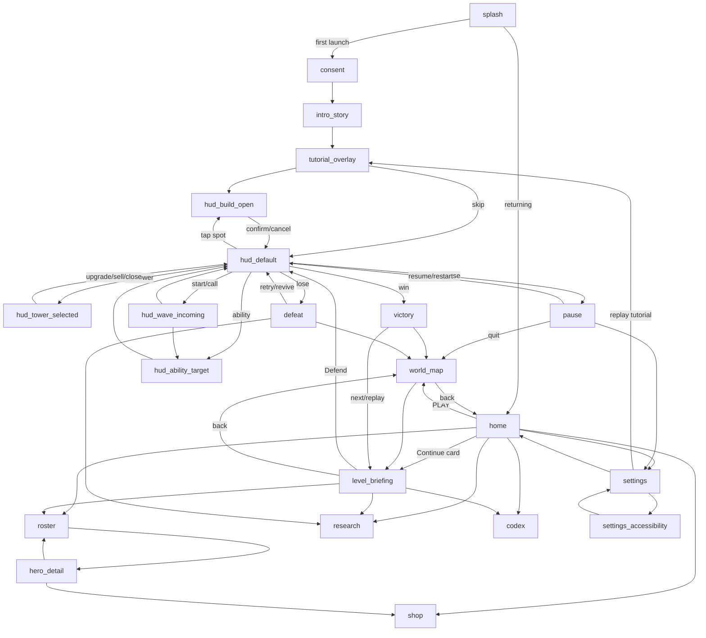

# 03 — UX/UI Designer: One-Thumb Portrait UX for *Hollowguard*

> **Lead note (v0.2):** unit placeholders renamed to the GDD canon (Talon Roost, Glowcap Lantern, Pinecone Lobber, Moonglass Prism, Screech Spire, hero Umber). The shop no longer sells currency bundles (Decisions Log #10, #11, #13).


> Role: UX/UI Designer · Stage: pre-production · Canvas: **390×844 pt portrait** (iPhone 14/15-class)
> Companion file: `salted-caramel-owl/wireframes/screens.json` (22 screens, clickable `goto` graph)

## TL;DR
1. **Information at the top, actions at the bottom.** Read-only status (Tree lives, sap, wave) sits in a thin strip at the top. Every frequent action is in a 160 pt **bottom tray** inside the thumb zone. Pause is the only control at the top, and that placement is deliberate.
2. **Build menu is a docked bottom tray, not a radial ring.** Tap a spot. The tray slides up with tower cards and the map shows a ghost tower with its range and light radius. Tap a card to preview it, then tap the same card again to confirm. Experts can double-tap. This avoids finger occlusion, edge clipping and fat-finger mis-builds.
3. **One-screen maps, no pan or zoom.** Enemies enter at the top and the Hollow Tree sits at the bottom. Build spots get 64 pt hit areas and snap to the nearest spot, and the Game Designer should keep spots below y≈200.
4. **Light is territory, and the HUD has to make it readable at a glance.** Lit ground and dark ground differ in three redundant ways: luminance, a hatch texture on dark ground, and sun vs. moon glyphs with solid vs. dashed outlines on build spots. None of them is color-only. A full-width **Light meter** (% lit plus a trend arrow) shows darkness pressure in the status strip.
5. **FTUE is the game.** A 3-panel skippable story leads into Level 1, which teaches through spotlight steps (one concept per step). Abilities unlock across L1–L3. The tutorial can be replayed from Settings.

---

## 1. Findings

### 1.1 Platform baselines (verified)
| Topic | Guidance | Source |
|---|---|---|
| Touch target, iOS | Buttons in iOS games "must be at least 44x44 pt"; minimum 28×28 pt for less important controls such as menus | Apple HIG – Designing for games; Game controls |
| Touch target, Android | Interactive elements should be "at least 48dp×48dp. Larger is even better." | Android Developers – Accessibility |
| Text size, iOS games | Default 17 pt, minimum 11 pt | Apple HIG – Designing for games |
| Contrast | WCAG AA: 4.5:1 for text up to 17 pt | Apple HIG – Accessibility |
| Color | "Convey information with more than color alone"; red-green and blue-orange pairs are the hard ones | Apple HIG – Accessibility |
| Motion | Respect Reduce Motion: cut automatic or repetitive animation, zoom, scaling and peripheral motion, and use fades instead of x/y/z transitions | Apple HIG – Accessibility |
| Safe areas | Respect safe areas and keep controls clear of the Home indicator and Dynamic Island | Apple HIG – Layout; Game controls |
| Cutouts, Android | Edge-to-edge is enforced for SDK 35 on Android 15, so content must handle cutout insets itself | Android Developers – Display cutouts |
| Control placement | Frequent buttons go near the thumb. Secondary controls such as menus go at the top. Prefer tapping game objects directly over extra virtual buttons | Apple HIG – Game controls |
| Feedback | Give a visible press state (e.g. glow) that shows even under the finger, plus sound and haptics | Apple HIG – Game controls |
| Onboarding | "Fast, fun, and optional". Teach through interactivity and context-specific tips. If skipped, make it findable later | Apple HIG – Onboarding |
| Personalization | Let players customize type size, control mapping, motion intensity and sound balance | Apple HIG – Designing for games |

### 1.2 Thumb reach (secondary, partly unverified)
- Hoober's field study (1,333 observations) reports that about 49% of users hold the phone one-handed. Grip changes often, so no heat map is universal, and the far top and the bottom corners are the least accurate areas *(search results only; primary pages blocked by network proxy, so unverified)*.
- **Working zone map for 390×844 (our heuristic):**

| Band (y, pt) | Reach | What we put there |
|---|---|---|
| 0–59 | system (status, Dynamic Island) | nothing |
| 59–131 | hard | read-only status + Pause (row 1), Light meter (row 2) |
| 131–230 | hard/stretch | spawn area of the map, so no build spots |
| 230–460 | stretch | upper map, where build spots get larger 72 pt hit areas |
| 460–650 | easy | most build spots and the Hollow Tree |
| 650–810 | easiest | action tray (build, upgrade, abilities, speed, waves) |
| 810–844 | system (home indicator) | nothing |

### 1.3 TD-specific touch patterns (practitioner evidence, unverified)
A search of indie TD devlogs and player feedback turned up the same recurring problems *(sources not retrievable through the proxy, so unverified)*:
- **Accidental placement.** A tap that both selects and builds causes mis-builds. The common fix is an explicit confirm or a movement threshold.
- **Occlusion.** Menus that open at the touch point hide the tower and range being placed. Players asked for menus to flip away from the finger.
- **Edge clipping.** Radial menus and placement get inaccurate near screen edges.
- **Snapping.** Snapping imprecise taps to the nearest valid cell is well received.
- **Slow menus.** Fade-in delays frustrate fast builders. The menu must open in ≤150 ms.

### 1.4 Build menu pattern comparison
| Pattern | Pros | Cons in portrait one-thumb | Verdict |
|---|---|---|---|
| Radial ring at spot | Spatially direct, genre-familiar | Finger covers the ring. Ring clips at edges. Spots high on the map put choices out of reach | ✗ |
| Drag card from tray onto map | Fast, tactile | Long drags to the upper map. Hard for limited dexterity. Drop precision issues | Optional expert mode later |
| **Tap spot → docked bottom tray → tap card twice** | All choices in the thumb zone. Map preview never occluded. Same pattern for build and upgrade | Two taps for experts (mitigated by double-tap) | **✓ Chosen** |

---

## 2. UX Principles for Hollowguard
1. **Reach follows frequency.** The more often an action is used, the lower and more central it sits. Rare or destructive actions go high or behind a confirm.
2. **The finger is in the tray, the eye is on the map.** Every preview (ghost tower, range ring, light radius, upgrade delta) draws on the map while the input happens below it.
3. **Confirm in place.** A confirm button appears where the finger already is (card flips to CONFIRM). Destructive actions (Sell, Quit, Restart) use hold-to-confirm or a dialog, plus a 3 s Undo for Sell.
4. **Light is territory and must be legible.** Players must always be able to see what ground is lit and buildable, what is dark, where the frontier is moving, which light keeps a spot alive, and which lights are being dimmed. Darkness creates tension but never hides the UI.
5. **Shape before color.** Every enemy, tower state and buff has its own silhouette or glyph. Color reinforces meaning and never carries it alone.
6. **Hide, don't disable.** Show only the controls that matter now. Controls appear as they are taught.
7. **Handedness-neutral core.** The primary action is centered. The tray mirrors in Left-Hand mode.
8. **Respect the OS.** Follow safe areas, Dynamic Type or font scale, Reduce Motion, haptics settings and system back.

### Sizing system
| Token | Value |
|---|---|
| Min hit target (any control) | 48×48 pt (meets Apple 44 and Android 48) |
| Primary action | ≥64 pt tall; tray cards 64×88 pt |
| Build spot | 40 pt visual / 64 pt hit (72 pt above y=460), snap radius 48 pt |
| Spacing between targets | ≥8 pt; Upgrade↔Sell ≥120 pt apart |
| Text | Body 17 pt, HUD numerals 17 pt bold tabular, floor 13 pt, scalable to 150% |
| Contrast | ≥4.5:1 default, 7:1 in High-contrast HUD |
| Side gutter | 16 pt |
| Feedback | Press glow visible around the finger, plus light haptic on preview and medium haptic on confirm |

---

## 3. In-Game HUD Layout (390×844)

```
y 0   ┌──────────────────────────────┐
      │ status bar / Dynamic Island  │  safe inset 59
y 59  │ [II]  🍃20   💧150   Wave 3/12│  status row 1 (read-only + Pause)
      │ ☀ ████████▒▒▒▒▒ 62% ▼       ☾ │  row 2: LIGHT METER (pressure)
y 131 ├──────────────────────────────┤
      │  ▼ spawn (shapes × count)    │
      │   ╲__path__                  │
      │ ////// ⊘☾ dark spot ///////  │  PLAYFIELD 519 pt tall
      │ ═══frontier═══››             │  one screen, no pan/zoom
      │   ◉☀ lit spot  🏮 lantern    │  lit ground = bright, plain
      │  /   ◉☀    ◉☀                │  dark ground = hatched ////
      │  \___ 🌳 Hollow Tree          │
y 650 ├──────────────────────────────┤
      │ (Hero) [ START / CALL EARLY ] (2x)│  ACTION TRAY (morphs:
      │  72pt        160×64        64pt│  build / tower / ability)
y 810 ├──────────────────────────────┤
      │        home indicator        │  safe inset 34
y 844 └──────────────────────────────┘
```

**Tray states.** The tray holds one context at a time, always 160 pt tall:
- **Default:** Hero ability, Start/Call wave, speed toggle.
- **Build:** up to 5 tower cards at 64 pt (5×64 + 4×8 = 352 ≤ 358 usable), plus Cancel.
- **Tower selected:** stats with deltas, Upgrade, Targeting, Sell (hold), Close.
- **Ability aim:** the reticle sits 60 pt *above* the finger. Tap-tap mode is available as an alternative.

### 3.1 Territory & pressure readability ("Light is territory")
| What the player needs to know | Encoding (colorblind-safe) |
|---|---|
| Can I build here? | Lit spot: solid outline, sun glyph, bright ground. Dark spot: dashed outline, moon glyph, hatched ground. Tapping a dark spot gives the toast "Too dark — extend light with a Lantern Owl" and never opens the tray |
| Where is the light boundary moving? | Bright **frontier line** with chevrons pointing in the direction it is advancing. Luminance-based, so it holds up in every color-vision mode |
| Overall pressure | **Light meter** (status row 2): lit share as a solid fill with a sun cap, dark share hatched with a moon cap, a numeric %, a ▲/▼ trend arrow and a danger tick at 25%. Wave start previews the coming darkness surge as a hatched segment |
| Which light keeps this spot alive? | Build tray tag: "LIT – stays lit while Lantern L2 at B1 burns" |
| A light is being dimmed | Draining ring plus a "!" badge on the lantern. Ground it supports flashes its outline once before turning dark. The tower panel offers **Relight**. Targeting mode **Snuffer** prioritizes the dimming enemy |
| My tower is in the dark | Moon glyph on the tower base. Owls still fight in the dark, but Upgrade is disabled with the reason "Relight ground to upgrade" |
| Gain preview | Lantern cards and the hero's Dawnburst ghost the lit ground they will add, and the meter previews the change (62% → 70%) |

Hue (warm amber vs. cool indigo) is decoration only. The *Darkness readability* setting can brighten the map but locks a minimum luminance gap between lit and dark ground. The *Territory pattern* setting offers hatch, dots, or outlines only.

**Speed controls:** a 1×/2× toggle with its state shown as text. An optional *Slow time while building* (0.25×) is on by default for L1–L3. Pause auto-triggers when the app is backgrounded.

---

## 4. Screen Inventory & Navigation

| # | id | Screen | Primary action (thumb zone) |
|---|---|---|---|
| 1 | splash | Splash / boot | Tap anywhere |
| 2 | consent | Privacy & age check | Continue (bottom, full width) |
| 3 | intro_story | 3-panel intro | Next / Skip |
| 4 | tutorial_overlay | FTUE overlay on Level 1 | Tap spotlit target |
| 5 | home | Hollow Tree hub | PLAY (center tab, raised) |
| 6 | world_map | World map / level select | Play Level N (bottom-right) |
| 7 | level_briefing | Briefing bottom sheet | Defend the Tree! |
| 8 | hud_default | HUD – default | Start/Call wave |
| 9 | hud_build_open | HUD – build tray | Tap card ×2 |
| 10 | hud_tower_selected | HUD – upgrade/sell | Upgrade |
| 11 | hud_wave_incoming | HUD – wave incoming | Call early (+sap) |
| 12 | hud_ability_target | HUD – hero ability aim | Drag-release / tap-tap |
| 13 | pause | Pause | Resume (lowest, largest) |
| 14 | victory | Victory | Next Level |
| 15 | defeat | Defeat | Retry |
| 16 | roster | Owl roster | Owl card |
| 17 | hero_detail | Hero detail | Level up |
| 18 | research | Tower research tree | Research node |
| 19 | shop | Shop | Item purchase |
| 20 | codex | Bestiary / codex | Entry card |
| 21 | settings | Settings | Done |
| 22 | settings_accessibility | Accessibility | Toggle options |



---

## 5. Per-Screen Specs
Full element lists are in `screens.json`. This section gives the essentials.

| Screen | Purpose | Key elements | Primary action | Thumb-zone placement |
|---|---|---|---|---|
| **Splash** | Brand + load | Logo, lantern-row loader | Tap to begin | Whole screen tappable |
| **Consent** | Policy gate | Neutral birth-year picker, consent toggles, policy link | Continue | Full-width button at y≈740; ATT prompt deferred to the first ad offer |
| **Intro story** | Set the hook | 3 captioned panels, ≤12 words each | Next | Skip top-right (deliberately secondary) |
| **Tutorial overlay** | Teach by doing | Scrim + spotlight, hand pointer, coach-owl card placed opposite the target | Tap target | Only the target is live; Skip at bottom-left in small text |
| **Home (Hollow Tree)** | Hub, fast re-entry | Sap pill, gear, tree cutaway with room hotspots, "Continue Level N" card, 5-tab bar | PLAY | Tab bar y 754–810; Continue card y≈520–600 |
| **World map** | Progress + choose | Vertical root path, 10 lantern nodes (stars, lock glyph), boss node | Play Level N | Auto-scroll current node to y≈560; Back in bottom bar, not top-left |
| **Level briefing** | Prepare | Darkness pressure (icon + word + starting % lit), enemy icons with NEW badge and light-interaction glyph, star goals, hero slot, loadout | Defend the Tree! | Bottom sheet, 70% height |
| **HUD default** | Play | Status strip + Light meter, one-screen map with lit/dark territory, frontier line, dimming warnings, tray (hero, wave, speed) | Start/Call wave | See §3 |
| **HUD build open** | Build safely (lit spots only) | Spot ring, ghost + range + territory-gain preview, "LIT – kept by Lantern B1" tag, meter preview, 4–5 cards, Cancel | Card tap ×2 | Tray; preview on map |
| **HUD tower selected** | Upgrade/sell/relight | Level pips, stat deltas (arrow + number), ground state, Upgrade, Relight (lanterns), Targeting (First/Strong/Close/Snuffer), Sell-hold, branch cards at T3 | Upgrade | Upgrade on the thumb side; Sell ≥120 pt away |
| **HUD wave incoming** | Warn + reward early calls | Banner, countdown, spawn shapes × count, darkness-surge preview on meter, lanterns on route flagged, one-time NEW-enemy tip | Call early | Center of tray |
| **HUD ability target** | Aim hero Dawnburst (relights ground) | Offset reticle, relight-area preview, hint | Release to cast | Starts at bottom-left ability button |
| **Pause** | Safe stop | Run summary, tip, Settings/Restart/Quit (confirm) | Resume | Resume lowest and largest |
| **Victory** | Reward, keep momentum | Stars with goal labels, sap, opt-in "double with ad" | Next Level | Bottom-right |
| **Defeat** | Teach, retry | "Why" card (which lanterns were snuffed, when darkness reached the Tree), one actionable tip, opt-in revive ad, Upgrade link | Retry | Bottom-right |
| **Roster** | Pick hero | 2-col owl grid, locked silhouettes | Owl card | Scrollable into reach |
| **Hero detail** | Grow hero | Portrait, abilities, stat deltas, cosmetic link | Level up | Bottom |
| **Research** | Meta upgrades | Bottom-up tree, node sheet, tower chips **at bottom**, free reset | Research | Cheapest nodes nearest the thumb |
| **Shop** | Fair monetization | Rewarded-ad freebie, cosmetics, pass, bundles, Restore purchases, confirm sheet | Buy | Lists scroll into reach; no loot boxes or fake timers |
| **Codex** | Learn enemies | Shape-coded tiles, light-interaction notes | Entry | Segmented toggle at bottom |
| **Settings** | Configure | Accessibility first, audio, haptics, handedness, confirm style, default speed, replay tutorial | Done | Done at bottom |
| **Accessibility** | Include everyone | Text size, CVD modes, Darkness readability, Territory pattern, high-contrast HUD, reduce motion/flashes, slow-time, tap-tap aiming, +25% targets, audio visual cues | Toggles | Live preview tile |

---

## 6. Recommendations (decisive)
1. **Adopt the tray-based build/upgrade model** (§1.4) and the 5-band layout (§1.2) as UX canon. Prototype it first in the vertical slice greybox.
2. **Level-design constraint for the Game Designer:** one-screen portrait maps, spawns at the top, the Tree at the bottom, no build spots above y≈230. Spots must be ≥72 pt apart center to center.
3. **Loadout cap ≤5 towers per level.** The tray fits 5 cards at 64 pt. If all 6 towers must show, cards shrink to 52 pt, which is still above 48 pt but tight. The Game Designer should decide.
4. **Ship the accessibility set at the vertical slice**, not post-launch. *Darkness readability* and *Territory pattern* are critical, because the hook is territory you read through light.
5. **Adopt the territory encoding in §3.1 as a hard art constraint.** Use luminance, texture and glyph, never hue alone, and lock a minimum luminance gap between lit and dark ground. The Art Director should verify it in grayscale renders.
6. **Every enemy gets a unique silhouette and glyph** (brief for the Art Director). Test all HUD and map screenshots in CVD simulation as a CI step (headless and automatable).
7. **Confirm grammar:** Build and Upgrade use tap-tap, Sell uses hold 0.6 s plus 3 s Undo, Quit and Restart use a dialog. Configurable in Settings.
8. **FTUE:** under 60 s from first tap to first tower built. Introduce concepts across L1–L3: build on lit ground → Lantern grows territory → dark spot can't be built → an enemy dims a light → Light meter → upgrade → speed → hero relight.
9. **Rewarded ads stay opt-in** at Victory, Defeat (revive once) and the Shop only. They never interrupt play. Defer the ATT prompt until the first ad is chosen.

## 7. Risks
| Risk | Impact | Mitigation |
|---|---|---|
| Darkness theme makes the game hard to read on small, dim screens or outdoors | Core hook backfires and hurts retention | Darkness readability setting, outline strength, HUD plates, outdoor-brightness playtest |
| Lit vs. dark territory is unclear under color-vision deficiency or glare | Players build in the wrong place and can't read pressure | Three-channel encoding (§3.1), grayscale and CVD screenshot tests in CI, tap-on-dark-spot telemetry |
| Territory overlays (hatch, frontier, rings) clutter a small map | Visual noise | Hatch at low contrast, rings only on selection, frontier as the single strong line |
| One-screen maps limit level variety | Repetitive levels | Vary path shape, light sources and moving darkness rather than map size. Pan can be revisited for boss levels only |
| Two-tap build feels slow to experts | Friction for mid-core players | Double-tap works, plus a single-tap expert option and optional drag-to-build later |
| Tray covers ~19% of the screen | Less playfield | Tray is translucent over the Tree area and never overlaps the path. The Tree sits just above it |
| Android cutout and edge-to-edge variance | Clipped HUD | Lay out from insets only and test in emulator profiles in CI |
| Thumb-zone data are secondary or unverified | Wrong placements | Validate with tap-heatmap telemetry in the vertical slice |

## 8. Open questions for the Owner
1. **Default look: how dark should dark ground be?** I recommend a *Balanced* default with clearly readable dark ground (hatch visible, enemies outlined) and an optional *Atmospheric* mode. The alternative is a near-black default that trades readability for mood. This sets the game's first impression.
2. **One-screen maps (no pan or zoom) as a hard rule for all 10 slice levels?** Best for one-thumb play, but it constrains level scale. I recommend yes.

## 9. Sources
Retrieved this session:
- Apple HIG – Designing for games: https://developer.apple.com/design/human-interface-guidelines/designing-for-games.md
- Apple HIG – Game controls (touch controls): https://developer.apple.com/design/human-interface-guidelines/game-controls.md
- Apple HIG – Accessibility: https://developer.apple.com/design/human-interface-guidelines/accessibility.md
- Apple HIG – Layout (safe areas): https://developer.apple.com/design/human-interface-guidelines/layout.md
- Apple HIG – Onboarding: https://developer.apple.com/design/human-interface-guidelines/onboarding.md
- Apple HIG – Menus (in-game menus): https://developer.apple.com/design/human-interface-guidelines/menus.md
- Apple HIG – Gestures: https://developer.apple.com/design/human-interface-guidelines/gestures.md
- Apple – UI Design Dos and Don'ts (44×44 pt): https://developer.apple.com/design/tips/
- Android Developers – Make apps more accessible (48dp): https://developer.android.com/guide/topics/ui/accessibility/apps
- Android Developers – Support display cutouts: https://developer.android.com/develop/ui/views/layout/display-cutout

Seen in search results only. The network proxy blocked retrieval, so these are **unverified**:
- Hoober, "How Do Users Really Hold Mobile Devices?" (UXmatters, 2013): https://www.uxmatters.com/mt/archives/2013/02/how-do-users-really-hold-mobile-devices.php
- Smashing Magazine, "The Thumb Zone": https://www.smashingmagazine.com/2016/09/the-thumb-zone-designing-for-mobile-users/
- Game Accessibility Guidelines – Basic: https://gameaccessibilityguidelines.com/basic/
- Google Accessibility Help – Touch target size: https://support.google.com/accessibility/android/answer/7101858
- Circuit Defender (itch.io), radial build and snapping notes: https://flunch1314.itch.io/circuit-defender
- Clockwork TD devlog #4, dynamic build menus: https://onewinter.itch.io/terrorformer-td/devlog/560592/clockwork-td-devlog-4-dynamic-build-menus
